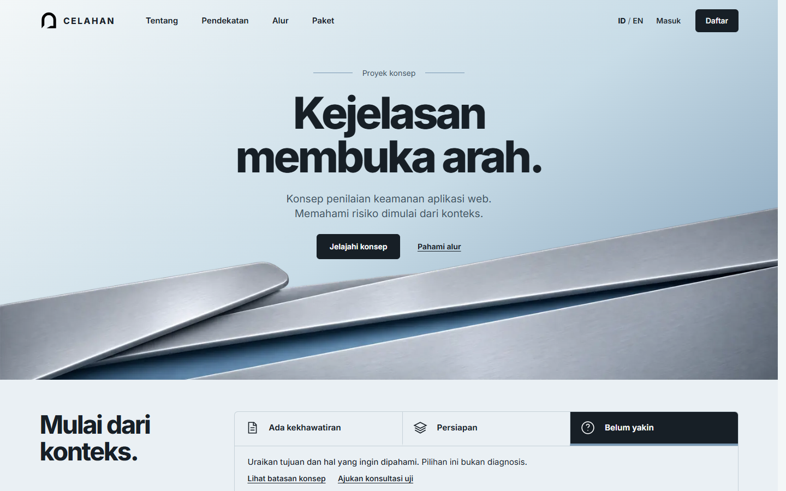
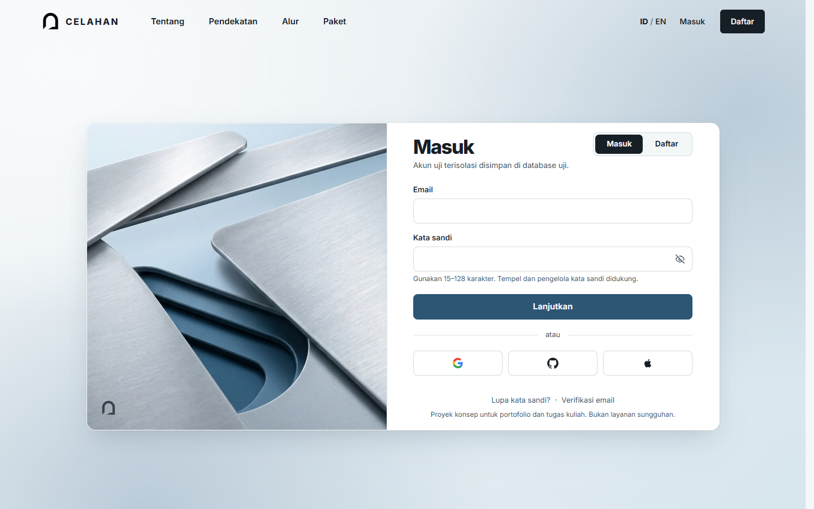
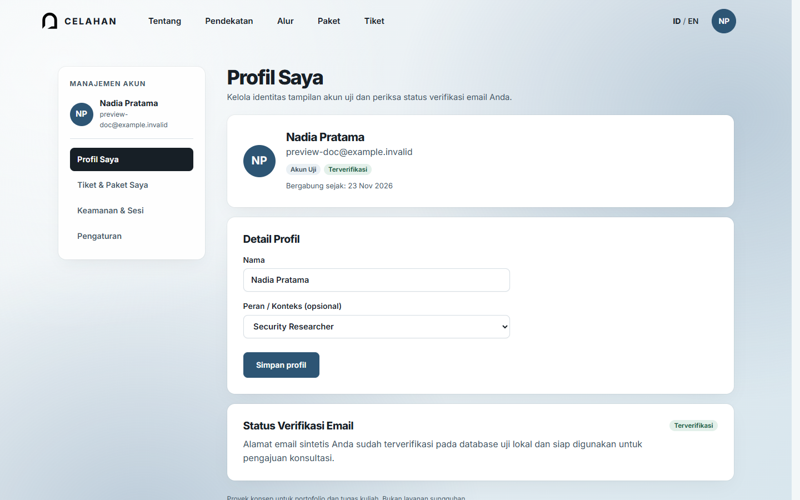
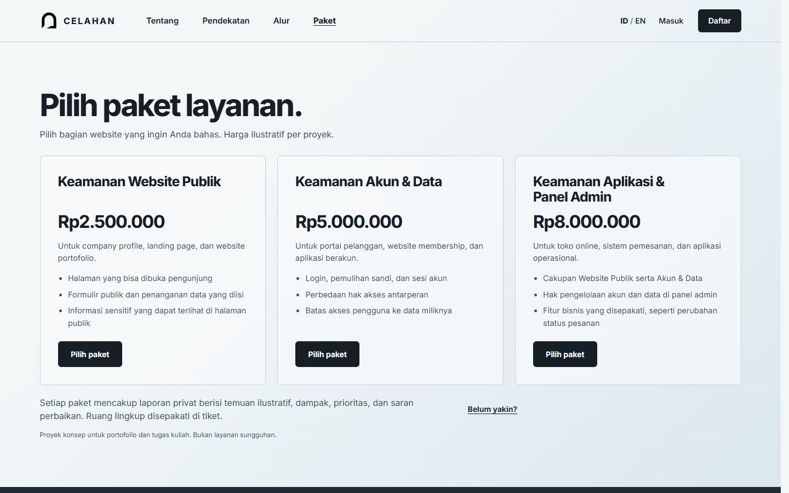
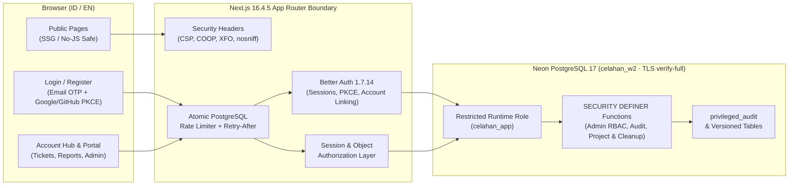

<div align="center">

# CELAHAN

**Bilingual Web Application Security Assessment Portal — Architecture, UX & Security Engineering Showcase**

[](https://nextjs.org/)
[](https://react.dev/)
[](https://www.typescriptlang.org/)
[](https://www.better-auth.com/)
[](https://neon.tech/)
[](#concept-boundary)

> **Proyek konsep untuk portofolio dan tugas kuliah. Bukan layanan sungguhan.**
>
> *A concept project for a portfolio and university coursework. Not a real service.*

<br />



</div>

---

## Overview

**CELAHAN** is a full-stack bilingual (**Bahasa Indonesia `/id/`** & **English `/en/`**) web application security assessment portal built as an end-to-end product design, frontend engineering, and backend security case study.

It demonstrates how a security-sensitive client portal should be engineered from the ground up: **least-privilege PostgreSQL roles**, **`SECURITY DEFINER` database guardrails**, **PKCE OAuth 2.0 (Google & GitHub)**, **atomic database-backed rate limiting**, **strict IDOR/RBAC isolation**, **versioned private reports**, and a custom **Glacier Steel** desktop design system with zero third-party runtime assets.

### Concept Boundary

- Accounts, OAuth sign-in, consultation tickets, scope approvals, private reports, and admin audit logs run against a real isolated **Neon PostgreSQL 17** database (`celahan_w2`).
- Security assessments, findings, remediation priorities, and retest outcomes are **illustrative only**.
- Visitor-entered target websites are **strictly treated as inert plain text** — CELAHAN never visits, resolves DNS, scans, previews, embeds, or auto-links submitted targets.

---

## Visual Showcase

<table>
  <tr>
    <td width="50%">
      
      <p align="center"><strong>Unified Auth Split-Card</strong><br /><sub>Single-screen Glacier Steel login/register with Google &amp; GitHub PKCE OAuth and inline password controls.</sub></p>
    </td>
    <td width="50%">
      
      <p align="center"><strong>4-Tab Account Management Hub</strong><br /><sub>Profile context, active package &amp; tickets, session revocation, OAuth status, language preference, and self-service deletion.</sub></p>
    </td>
  </tr>
  <tr>
    <td width="50%">
      
      <p align="center"><strong>Illustrative Service Packages</strong><br /><sub>Bilingual scope tiers with package-linked consultation intake and versioned scope approval.</sub></p>
    </td>
    <td width="50%">
      
      <p align="center"><strong>Glacier Steel Public Shell</strong><br /><sub>Self-hosted Inter WOFF2, static brushed-metal WebP art, and progressive enhancement without JS.</sub></p>
    </td>
  </tr>
</table>

---

## Architecture & Security Flow



---

## Role-Based Access Control (RBAC) Matrix

CELAHAN enforces deny-by-default authorization at both the Next.js server boundary and PostgreSQL `SECURITY DEFINER` layer:

| Role | Permitted Access | Strictly Restricted / Denied |
| --- | --- | --- |
| **Anonymous Visitor** | Public concept pages (`Home`, `About`, `Process`, `Packages`, `Privacy`), `Log in`, `Sign up`. | All private APIs (`/api/account/*`, `/api/tickets/*`, `/api/projects/*`, `/api/admin/*`) and all private routes (`401`/`403`/redirect). |
| **Standard User** *(Email / Google / GitHub)* | Own profile & context, own active sessions, own consultation tickets & replies, own approved projects & published reports, simulation reset, and self-service account deletion. | Other users' tickets, projects, or sessions (anti-IDOR `404`), all `/admin/*` pages & APIs (`403`/`404`), internal admin notes, and role escalation. |
| **Verified Admin** | Full consultation queue, separate internal admin notes, versioned scope proposals, project creation & report publishing, retest management, `/admin/accounts/` overview, disabling standard users, revoking standard user sessions, and immutable `privileged_audit` log. | Promoting/revoking Admin roles via browser (**CLI owner DB only**), disabling own account (`SELF_PROTECTED`), or modifying peer Admins (`ADMIN_PROTECTED`). |

---

## Key Capabilities & Security Controls

| Area | Implemented Controls |
| --- | --- |
| **Authentication & OAuth** | Better Auth `1.7.14` with **Google & GitHub PKCE (`S256`) OAuth** (verified-email enforcement, safe internal redirect validation, fail-closed callback handling, verified account linking, zero external avatar fetches) + isolated local email/password OTP (`15–128` char passwords, hashed 5-minute OTPs). |
| **Session Hygiene** | 8-hour database-backed `HttpOnly` `SameSite=Lax` sessions (no client token storage), instant session revocation on password change (`revokeOtherSessions: true`), manual per-device revocation in Account Hub, and instant wipe on admin disable/revoke. |
| **Rate Limiting** | Shared atomic PostgreSQL rate limiter ([rate-limit.ts](src/server/rate-limit.ts)) returning accurate `429 RATE_LIMITED` + `Retry-After` headers across auth, OAuth, account, ticket, project, follow-up, and admin endpoints. |
| **Database Hardening** | Least-privilege pooled runtime role (`celahan_app`), separate owner credential (`.env.database.local`) for hash-checked migrations (`001`–`012`) and CLI admin ops, `sslmode=verify-full`, parameterized SQL only, and `SECURITY DEFINER` functions with `SET search_path = pg_catalog, pg_temp`. |
| **HTTP & Browser Headers** | Strict `Content-Security-Policy` (`frame-ancestors 'none'`, `object-src 'none'`, `base-uri 'none'`, `img-src 'self'`), `X-Frame-Options: DENY`, `Cross-Origin-Opener-Policy: same-origin`, `X-Content-Type-Options: nosniff`, `Referrer-Policy: no-referrer`, `Cache-Control: private, no-store` on private routes, and static caching on `/artwork/*`. |
| **Workflow Depth (W1–W5D)** | Package-linked consultations, live incremental ticket polling, confirmed Asia/Jakarta scheduling, versioned scope approval, immutable private report versions, structured findings, and single-cycle illustrative retesting. |

---

## Tech Stack

| Layer | Technology (Pinned) | Purpose |
| --- | --- | --- |
| **Framework** | Next.js `16.4.5` (App Router) · React `19.3.1` · TypeScript `5.9.3` | Server-first rendering, typed route handlers, and focused client islands. |
| **Authentication** | Better Auth `1.7.14` | Database sessions, password hashing, hashed email OTP, and Google/GitHub PKCE OAuth. |
| **Database** | Neon PostgreSQL `17` · `pg` `8.23.1` | Pooled parameterized SQL, hash-checked migrations (`database/001`–`012`), and `SECURITY DEFINER` guardrails. |
| **Design & Assets** | Custom CSS (`Glacier Steel`) · Inter Latin WOFF2 (`48 KiB`) · WebP metal art | Zero external CDN/font/image fetches; 4 static material assets documented in `design/desktop/material-manifest.json`. |
| **Verification** | Node `node:test` · ESLint `10` · Python Playwright (Chrome) | Unit tests (28 suites), live OAuth/RBAC/IDOR security harnesses, and full ID/EN browser E2E. |

---

## Local Setup & Configuration

**Prerequisites:** Node `>=26.10.0 <27`, npm `>=12 <13`, and an isolated Neon PostgreSQL database (`celahan_w2`).

```powershell
$env:NEXT_TELEMETRY_DISABLED = '1'
npm ci --ignore-scripts
npm run dev
```

`npm run dev` serves on `http://127.0.0.1:3100` (`/` redirects to `/id/`, English at `/en/`).

### Environment Files (Ignored by Git)

1. Copy variable names from [.env.example](.env.example) into `.env.local` (runtime config loaded by Next.js) and `.env.database.local` (owner-only `DATABASE_MIGRATION_URL`, never loaded by Next.js).
2. To enable real **Google & GitHub OAuth** locally, add your free OAuth app credentials to `.env.local`:
   ```env
   GOOGLE_CLIENT_ID=<your-google-client-id>.apps.googleusercontent.com
   GOOGLE_CLIENT_SECRET=<your-google-client-secret>
   GITHUB_CLIENT_ID=<your-github-client-id>
   GITHUB_CLIENT_SECRET=<your-github-client-secret>
   ```
   - **Google Authorized Redirect URI:** `http://127.0.0.1:3100/api/auth/callback/google`
   - **GitHub Authorization Callback URL:** `http://127.0.0.1:3100/api/auth/callback/github`

### Database Migrations & Admin CLI

```powershell
# Apply hash-checked SQL migrations (001–012)
npm run db:migrate

# List registered accounts, roles, and connected OAuth providers
npm run account:admin -- list

# Promote / revoke an active, verified account (CLI-only by design)
npm run account:admin -- grant_admin user@example.com
npm run account:admin -- revoke_admin user@example.com
npm run account:admin -- disable_account user@example.com
npm run account:admin -- enable_account user@example.com
```

---

## Verification & Quality Gates

```powershell
# Static analysis, type safety, unit tests (28/28), and production build
npm run lint
npm run typecheck
npm test
npm run build

# Full isolated integration + Chrome E2E suite (W4, W5A–W5D, RBAC, IDOR)
node --env-file=.env.local --env-file=.env.database.local tests/integration/consultations.mts --follow-ups --browser

# Public shell & no-outside-origin Playwright checks
.\.venv\Scripts\python.exe tests/e2e/public-site.py --base http://127.0.0.1:3100
```

---

## Documentation Index

Start with [docs/README.md](docs/README.md) for the complete documentation map:

- **Product:** [Project Brief](docs/product/PROJECT_BRIEF.md) · [PRD](docs/product/PRD.md) · [User Flows](docs/product/USER_FLOWS.md) · [Service Operations](docs/product/SERVICE_OPERATIONS.md)
- **Design:** [Aperture / Layers Design Lock](docs/design/DESIGN_DIRECTION.md) · [Logo Guidelines](docs/design/LOGO_GUIDELINES.md) · [Portal UX Spec](docs/design/PORTAL_UX_SPEC.md)
- **Engineering:** [Architecture](docs/engineering/ARCHITECTURE.md) · [Data & Access](docs/engineering/DATA_AND_ACCESS.md) · [Quality & Security](docs/engineering/QUALITY_AND_SECURITY.md)
- **Planning & Governance:** [Decisions (DEC-01–78)](docs/planning/DECISIONS.md) · [Implementation Plan](docs/planning/IMPLEMENTATION_PLAN.md) · [Agent Instructions](AGENTS.md)
- **Latest Validation:** [OAuth, Admin RBAC & Security Audit (2026-11-23)](docs/validation/2026-11-23-oauth-and-admin-rbac.md) · [Account UI & Hub (2026-11-21)](docs/validation/2026-11-21-account-ui-and-hub.md)

---

### Release Gates

Hosted public deployment remains separately authorized. Before public production release, finalize public HTTPS origin configuration, production email delivery (if password enrollment is opened), retention/backup procedures, and privacy contact details. Git operations are entirely manual.
