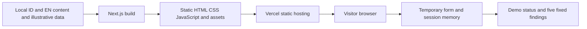

# CELAHAN — Architecture

Status: Technical baseline for review and foundation-stage verification; not implemented  
Updated: October 27, 2026  
References: [PRD](PRD.md), [User Flows](USER_FLOWS.md), [Content](CONTENT_AND_SIMULATION.md)

## 1. System boundaries

Next.js App Router and TypeScript are the owner's specified stack. The proposed baseline is static export (`output: 'export'`), with local content rendered at build time and limited client-side interactions. There is no application backend, API, database, Server Action, or server-side collection of user inputs at runtime.



Entered URLs have no path from the client validator to the network. Normal hosting requests contain only public routes/assets. Using React Server Components at build time does not imply an application server receiving inputs at runtime. Official documentation describes static export and its build output. [Next.js static exports](https://nextjs.org/docs/app/guides/static-exports)

## 2. Routing and locales

- Build `/id/` and `/en/` prefixes statically; page slugs follow User Flows.
- Locales and pages form an allowlist. Never use user input to construct route paths or module names.
- The locale root layout outputs the correct `html lang` before JavaScript runs.
- ID/EN dictionaries share keys/types. Informational content is rendered at build time; client components receive only the strings they need.
- No language-detection middleware/proxy, cookies, or translation API. Hosting redirects `/` to `/id/`, with an HTML entry page containing links for static-preview fallback.
- Language switching uses equivalent routes and full navigation after the reset guard. This intentionally creates a new provider and does not transfer session data.

The locale-segment and dictionary approach follows App Router support; locale routes can be pregenerated. [Next.js internationalization](https://nextjs.org/docs/app/guides/internationalization)

### Foundation risks that must be verified

Locale root layouts, the entry page, custom global 404 handling, and static export must be tested together on the selected Next.js version. Global 404 handling has its own convention; the referenced documentation marks `global-not-found` as experimental. Do not enable it without a decision and build verification. [Next.js not-found](https://nextjs.org/docs/app/api-reference/file-conventions/not-found)

P3 must produce a custom `/404.html` served with HTTP 404 for unknown paths. If the framework convention is incompatible with static export, use a static 404 fallback generated from a local template during the build and tested on hosting, then record the concrete choice in Decisions. Do not solve this by adding server state, an unbounded runtime catch-all, or a site-wide SPA fallback returning HTTP 200.

## 3. Planned structure

The structure below is a plan, not a list of existing files. Final root-layout/404 organization depends on P3 verification.

```text
src/
  app/
    [locale]/
      layout.tsx
      page.tsx
      services/page.tsx
      process/page.tsx
      request/page.tsx
      request/received/page.tsx
      report/page.tsx
      privacy/page.tsx
      not-found.tsx
    (entry)/
      layout.tsx
      page.tsx
  components/
    layout/             # Header, footer, menu, language switch
    ui/                 # Button, field, dialog, disclosure
  features/
    request/            # Form, validator, error messages
    simulation/         # Provider, reducer, ticket, status
    report/             # Table, mobile list, detail
    companion/          # Guide topics, panel, mascot presentation
  content/
    findings.ts         # Canonical domain data and stable IDs
    id.ts               # Indonesian copy and explanations
    en.ts               # English copy and explanations
  lib/
    i18n.ts             # Locale, dictionary, page-key mapping
  styles/
    tokens.css
    globals.css
public/
  brand/
  mascot/
  fonts/
scripts/                # Only build helpers that are actually needed
tests/
  unit/
  e2e/
```

Do not create empty API, database, auth, or backend-schema directories. Mobile/desktop UI shares domain logic. Separate components only where presentation genuinely differs, such as tables and mobile lists.

## 4. Data and function contracts

These contracts describe interfaces for later implementation; they are not runnable application code.

| Contract | Definition |
| --- | --- |
| `Locale` | `id` or `en` |
| `PageKey` | `home`, `services`, `process`, `request`, `received`, `report`, `privacy` |
| `RequestDraft` | `name: string`, `applicationUrl: string`, `needs: string`, `authorized: boolean` |
| `ValidationErrors` | Maps field names to stable error codes rather than mixed-language text |
| `Stage` | `awaiting_permission`, `testing`, `report_ready` |
| `DemoSession` | `ticket: string`, `stage: Stage`, `source: 'illustration'`; or `null` for no session |
| `Finding` | `id`, `order`, `owaspCategory`, `locationKey`, `score: number`, `severity`, `remediationStatus` |
| `FindingCopy` | Localized title, location label, explanation, and remediation guidance |
| `validateRequest(draft)` | Returns structured errors; a pure function without I/O |
| `createDemoTicket()` | Generates `DEMO-XXXXXXXX` on the client; never called during rendering/build |
| `reduceDemo(session, event)` | Applies permitted transitions; inapplicable events leave state unchanged |
| `routeFor(locale, pageKey)` | Generates a public route from the allowlist; does not accept user-entered URLs |
| `getDictionary(locale)` | Selects typed local content; makes no translation request |

Separate finding remediation status (`fixed`/`not_fixed`) from session stage. Do not recalculate scores. Enums and IDs are not translated; presentation strings are.

## 5. State and lifecycle

Place the client provider in the locale layout that persists during internal navigation. It manages the draft and session; the form mounts only on the request page. A valid submission generates a ticket, clears the draft, and navigates to the success page on the client.

Do not serialize session data into server props, URLs, cookies, logs, storage, or caches. SessionStorage is prohibited even though it is tab-scoped. Language preference resides in the path; assistance preferences remain in memory.

Reloading creates an empty provider. Restoring a document from the back-forward cache must clear sensitive state, for example through a `pageshow` lifecycle check for restored documents. Disable native form autofill as a retention-reduction measure, but do not claim full control over browser autofill, history, or internal memory.

Distinguish client-not-ready from no-session state so server-rendered HTML does not fabricate tickets or progress. Generate randomness only on submission. Protect against double submission with a synchronous handler guard before navigation.

## 6. Forms without a transmission path

- Render the form without an active native submission path; keep submission disabled until hydration is ready and provide a `noscript` explanation.
- Prevent default behavior before validation. No `action`, Server Action, fetch, or alternate request.
- Apply CSP `form-action 'none'` as an additional hosting-side protection; do not rely on the header alone.
- To prevent fallback GET submission from carrying data, do not add serializable native `name` attributes where unnecessary; use `id` for labels and explicit state. Test Enter and disabled JavaScript against production output.
- Never place the application address in `href`, `src`, style URLs, backgrounds, favicons, iframes, or resource attributes.
- Treat all inputs as plain text; do not use `dangerouslySetInnerHTML`, unrestricted HTML in Markdown, or dynamic code evaluation.

## 7. Dependencies and assets

| Need | Baseline | Rationale |
| --- | --- | --- |
| Framework | Next.js, React, React DOM | Requested stack |
| Types/lint | TypeScript, React/Node types, ESLint, and compatible Next configuration | Static checks |
| Styling | Custom CSS/CSS Modules; Tailwind optional if selected | The design does not require a large component library |
| State and validation | React state/reducer + local validator | Small form; no additional state/form/schema library needed yet |
| i18n | Typed dictionaries and route allowlist | Two languages and a limited page set; no runtime translation service needed |
| Browser tests | Playwright as a proposed development dependency | End-to-end checks for network, storage, navigation, mobile, and languages |
| Unit tests | Vitest as a proposed development dependency | Critical validator/reducer behavior can be tested without UI |
| Accessibility | Manual checks; development-only axe-core if needed | Helps identify DOM issues without replacing human review |

Versions are not selected in this document. During P3, check supported stable releases, select compatible versions, explain added packages, and record the lockfile and runtime. Local fonts/assets avoid third-party requests during visits. Choose an animation library only if the design requires capabilities beyond CSS.

## 8. Build, hosting, and metadata

Planned script contract: `npm run dev`, `npm run lint` (explicit ESLint), `npm run typecheck`, `npm run test`, `npm run test:e2e`, `npm run build`, and `npm run preview` for static output. These scripts do not exist yet; update the README once they do. Do not assume the build runs lint automatically.

The target static output is `out/`, with consistent trailing slashes. Runtime image optimization is unnecessary; optimize assets before building or use a loader compatible with static output. Sitemap/metadata origin is public configuration, not a secret; finalize the domain before publication.

Configure static-hosting headers and redirects in Vercel rather than relying on Next server configuration that does not apply to static output. [Vercel project configuration](https://vercel.com/docs/project-configuration)

Check locale canonicals/alternates and `html lang` in generated HTML. Success and demo-report routes use `noindex`; the sitemap contains only informational routes intended for publication. Tickets and inputs must not appear in metadata, build artifacts, or social previews.

## 9. Risks and follow-up decisions

| Risk | Response |
| --- | --- |
| Locale/404 layouts are incompatible with the selected version | P3 verifies the build and HTTP 404 behavior before feature expansion; record the fallback choice |
| CSP blocks hydration or is too permissive | Derive it from production output; hash actual inline scripts where necessary; do not add `unsafe-eval` to hide errors |
| Cross-language state preservation requires serialization | Use the baseline confirmation-and-reset flow, not storage |
| The mascot increases bundle size | Lazy-load assistance and noncritical assets; limit motion; keep core features independent |
| Hosting enables analytics/injection outside application code | Audit configuration and production network behavior before making privacy claims |

Technical sources were checked on October 27, 2026. This document records a design and its verification points, not a compatibility guarantee for an application that has not been built.
