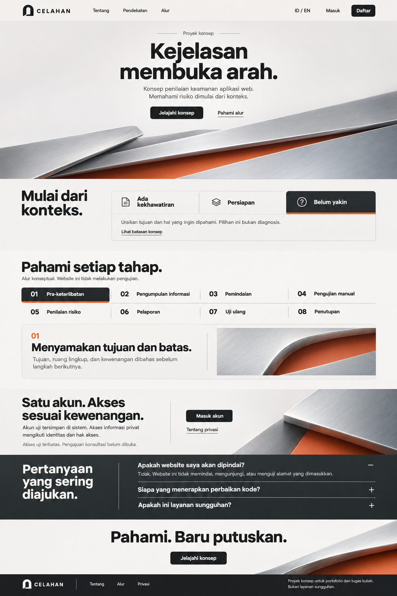

# CELAHAN — Aperture / Layers Desktop Design Lock

Status: Layers desktop with the owner-selected Glacier Steel palette and static material imagery under DEC-67.
Updated: November 8, 2026
Authority: [DEC-63 and DEC-67](../planning/DECISIONS.md#confirmed-decisions)
References: [PRD](../product/PRD.md), [Account UX](PORTAL_UX_SPEC.md), [Logo](LOGO_GUIDELINES.md), [Plan](../planning/IMPLEMENTATION_PLAN.md)

## Approved reference and scope

The owner selected **design 2 — Aperture / Layers** from the five complete desktop homepage candidates generated on November 6. The instruction was to lock its layout, design, colors, typography, consistency, interactive visuals and animation intent before proceeding to implementation. This selection supersedes the earlier recommendation of candidate 1 or a combination with candidate 4. Use candidate 2 itself as the visual authority.

Canonical reference: design/desktop/aperture-layers-approved-v1.png. This is an unchanged copy of the built-in image tool output exec-bf49b761-de1d-434e-95ac-785d5582383e.png, originally generated in the current Codex image session and delivered as 02-aperture-layers.png. It is a generated design reference, not a captured implemented website. The retained Open Threshold source was supplied as brand input. No third-party website screenshot was used as an image input; the prior Aperture concept was a supporting visual reference.

SHA-256: e51fcc5025768e6a6161f0aa3a9dbbc84058661c256ee85b29c8c7480d182494.
File size: 1,840,653 bytes. Keep the complete original; do not overwrite it with a cropped or recompressed export.

DEC-63 selected the desktop direction; the subsequent DEC-64 instruction authorized implementation, animation, tests and optimization. The public desktop homepage/shared shell now follow this contract; see [actual validation](../validation/2026-11-06-layers-desktop.md). No W4/W5 writes, replacement services/reports, phone implementation or deployment are authorized. Other candidates remain unselected exploration.

DEC-67 selects [02 Glacier Steel](../../design/desktop/glacier-steel-approved.png) for palette and metal. The original Layers reference remains the composition reference except for the owner-directed desktop spacing below.

## Visual character

Satin aluminum sheets overlap above an anodized steel-blue inner layer. Compact typography, frost surfaces, graphite controls and a dark FAQ keep the material from competing with the content.

## Page composition

Preserve this order, hierarchy and component arrangement. Adapt actual heights to readable live content, desktop width and both locales rather than stretching the reference into a single background.

| Area | Locked composition | Future behavior |
| --- | --- | --- |
| Shared header | Transparent over the homepage gradient, with the public links grouped beside Open Threshold/CELAHAN and ID/EN and account entry on the right. Frost surface on interior pages | Native navigation and current session-derived account capabilities; do not add a separate dashboard or sidebar |
| Hero | Centered concept label, two-line headline, short supporting copy, two actions and a wide static layered-metal photograph | Primary opens the public context explorer. Secondary links to the conceptual process. |
| Context explorer | Left heading “Mulai dari konteks.”; larger right module with three equal horizontal choices above a shared explanation panel | “Ada kekhawatiran”, “Persiapan”, “Belum yakin”; show the last selected in the reference. Selection changes only educational guidance, with no intake submission or diagnosis |
| Process explorer | Heading/subtitle, eight steps in a four-column by two-row grid, then one wide detail panel with text left and a material crop right | Exactly one selected stage. A steel-blue underline marks the selected control and the explanation updates in place |
| Package preview | DEC-71 inserts three frost panels after the process explorer and before the account invitation. | View package links to the corresponding package on a dedicated page. The shared navigation links to that page, where the scope, illustrative prices and Choose package actions appear. |
| Account invitation | Light three-part horizontal composition: heading/body left, account/privacy actions in the middle separated by a fine vertical rule, material crop right | Connect to real authorized account routes; disclose limited test access and pending consultation. No fabricated ticket or report preview |
| FAQ | Graphite full-width band; large heading in a narrower left column; three line-separated question rows in the wider right column; first answer open in the reference | Accessible independent disclosures with visible plus/minus and clear keyboard focus |
| Closing | Light centered “Pahami. Baru putuskan.” and one filled CTA with an aluminum/steel-blue crop from the lower-right | CTA returns to the public concept explorer |
| Footer | Dark horizontal band; monochrome logo left, short navigation next, exact disclaimer right | Native links and full readable disclosure; EN adds its translation |

Header public labels in the reference are Tentang, Pendekatan and Alur. They must point to actual existing pages or the corresponding homepage sections, including from supporting pages. Fragment destinations must account for the real header behavior. A sticky or hide-on-scroll header is not established by the image; use normal document flow unless subsequently justified.

On desktop, the process explorer occupies one viewport and the account invitation and FAQ share the next. Center each block's content vertically within its available space. Use a minimum height so longer content and open answers can expand the blocks in normal scroll flow. Center both account action labels on the same axis.

Do not replace the selected segmented context control with expanding image slices: that was an earlier generation prompt idea, not the chosen raster's actual interface. Likewise, keep this design's 4×2 process grid rather than importing another candidate's vertical rail.

## Palette and material

Glacier Steel uses a continuous three-stop gradient from frost through ice blue to steel behind the homepage header and hero. Restrained tints from the same palette carry through the process, account invitation, FAQ and closing. The context surface and footer remain solid to separate the reading blocks.

| Role | Working value | Use |
| --- | --- | --- |
| Frost | #F3F7F8 | Hero gradient start, header and main surface |
| Ice blue | #C8DCE7 | Middle hero gradient stop |
| Steel | #7897B2 | Hero gradient end and selected underlines |
| Pale surface | #EAF0F4 | Context and account invitation |
| Light reverse ink | #F8FAFB | Dark-section text and labels |
| Main ink | #171F26 | Headings, body and filled controls |
| Secondary ink | #40525F | Supporting copy |
| Hairline | #C5D1D8 | Panel outlines and separators |
| Steel ink | #2D5574 | Stage numerals and focus on light surfaces |
| Dark surface | #212A32 | FAQ and footer |

Preserve brushed grain, natural plate edges and believable overlap in each static image. The hero, account and detail WebP exports and their source provenance are recorded in the [material manifest](../../design/desktop/material-manifest.json).

## Typography and spacing

Select **Inter** as the implementation family: a single coherent sans-serif family, with display optical sizing where supported. This is a deliberate practical match to the approved raster's grotesk typography, not a claim that the generated pixels reveal an original font file.

Inter uses SIL OFL 1.1, verified from the [official site](https://rsms.me/inter/) and [upstream license](https://github.com/rsms/inter/blob/master/LICENSE.txt). The implementation self-hosts an official Google Fonts Latin variable WOFF2 (48,256 bytes, weights100–900), with actual sources/hash in [the material manifest](../../design/desktop/material-manifest.json) and public/fonts/Inter-OFL.txt. Other scripts use system fallbacks. No runtime font CDN is contacted. The initially obtained complete font was replaced by the smaller Latin export.

Working desktop scale, to tune against the actual browser reference:
- Hero: approximately 72–80 px at a 1440 px viewport, weight 800, line-height about 0.98–1.04, tracking around -0.045em.
- Section headings: approximately 40–48 px, weight 700–800, tight but readable leading.
- Detail headings: approximately 28–34 px, weight 700.
- Body: 16–18 px, weight 400, line-height 1.45–1.6.
- Navigation/control labels: 14–16 px, weight 500–600. Stage numbers share the same family and use tabular figures where useful.
- Small disclosure copy: remain readable; do not shrink it merely to match raster proportions.
- Keep a 12-column desktop alignment grid, a shared content width around 1280 px at 1440 px viewport width, and approximately 64–80 px outer margins.
- Use a shared 8 px spacing rhythm with enough breathing room around each desktop reading block.
- Primary buttons are graphite with off-white text, approximately 44–48 px high with a modest 6–8 px radius. Secondary actions are text links. Panels have fine borders and a similar small radius, not pill corners.
- Retain the current approved logo geometry/wordmark identity; changing the body font does not redesign the logo.

These numeric values are implementation starting points within the locked appearance, not owner assertions of exact measured source CSS. Live ID/EN text, enlargement and desktop widths must remain readable without clipping or forced identical line breaks.

## Interaction contract

DEC-66 restores still material images across the desktop homepage. The native controls below describe the public interactions.

| Element | Behavior | Constraints |
| --- | --- | --- |
| Material images | Static hero, process, account and closing images | Use intact artwork with natural metal edges and a readable foreground |
| Context choice | Selected tab fills dark and receives the steel-blue underline; related copy changes with a brief fade/small translation | One selection; preserve focus; selection is local ephemeral UI only. Reserve sufficient panel height to prevent distracting jumps |
| Process stage | The active step uses the same selection treatment and one detail panel changes in place | Educational only, never “start testing”, fabricated scan logs, progress percentages or private-project state |
| FAQ | Plus/minus changes with a modest expansion/collapse | Real disclosure semantics, keyboard operation, no hidden answer that remains focusable |
| Buttons/links | Brief hover/focus/pressed feedback consistent across the page | Hover is never required to discover content; include visibly distinguishable keyboard focus |
| Account/navigation | Normal native navigation and real existing account outcomes | Animation must not simulate successful login, ticket persistence or any unimplemented workflow |

Reduced motion applies to the existing control feedback. The context choices, process stages and disclosures are usable without JavaScript.

## Content and access boundaries

- Preserve the exact Indonesian footer/form disclaimer: **Proyek konsep untuk portofolio dan tugas kuliah. Bukan layanan sungguhan.** EN adds its translation.
- Public context guidance is not a new service catalog, consultation submission or automatic diagnosis.
- Preserve the eight educational stages and their no-testing explanation. Do not restore retired service names, scopes, findings or report samples.
- Keep the account entry beside ID/EN and retain the session/role/ownership contracts in Account UX. Tickets and reports are not public guest navigation.
- User-entered websites remain inert text. No target visits, scans, DNS, embeds or input-derived resources.
- New service/report content, phone design, W4/W5 operations and publication retain their separate scope gates.
- Design 2 locks this desktop homepage and establishes shared visual tokens. It does not approve unseen account, admin, ticket or private-report layouts.

## Implementation review

Compare rendered desktop output to the reference: hierarchy, centered hero, lower metal layers, context, normal 4×2 process/detail, account area, dark FAQ, closing/footer and type/color consistency. At 200% text enlargement, component container queries reflow choices/stages to keep labels readable. This accessibility adjustment does not establish a dedicated phone experience.

Verify ID/EN at relevant desktop widths including 1024, 1366, 1440 and 1920 px; keyboard/focus, selected/open states, reduced motion, enlarged text, navigation, no-JS public reading, image/font loading and measured payload/layout stability. Preserve isolated account checks and retired-route denial without resetting manually used synthetic accounts for visual work. A design lock is not a runtime accessibility, performance, security or deployment result.

## Current record

DEC-67 applies Glacier Steel and refines the desktop reading blocks. See [Glacier Steel validation](../validation/2026-11-08-glacier-steel.md) and the earlier [static-material restoration](../validation/2026-11-08-static-material.md).
