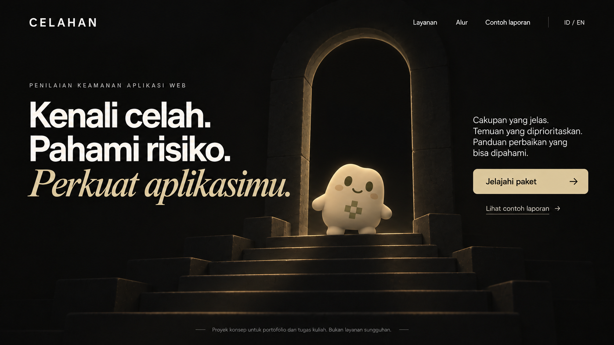

# CELAHAN — Approved Hero Reference and Design Continuity

Status: Desktop hero approved; four v1 pet concepts and shared rules generated for review; complete pages/mobile remain to be designed  
Updated: October 27, 2026  
References: [Design Direction](DESIGN_DIRECTION.md), [Visual References](VISUAL_REFERENCES.md), [Service Packages](../product/SERVICE_PACKAGES.md), [Implementation Plan](../planning/IMPLEMENTATION_PLAN.md)

## 1. Approved master



The owner explicitly approved the revised hero with the small pet and subdued doorway, and asked that future implementation stay visually faithful to it. This file is the primary visual target for the desktop hero. Earlier screenshots are supporting inspiration; the first generated Minecraft-humanoid/bright-portal preview was rejected and must not be used as the target.

| Record | Value |
| --- | --- |
| Repository path | `design/references/home-hero-desktop-approved-v1.png` |
| Format | PNG |
| Dimensions | 1,672 × 941 pixels |
| Size | 1,571,192 bytes |
| SHA-256 | `4c375b38afe8ed1996c3f3c452ae7cc61f3074a217a030701b9a5287093215fd` |
| Production | Built-in image generation; selected revised output, copied unchanged into the project |
| Approval scope | Hero composition, dark lighting, warm color direction, and small pet aesthetic |

The source/copy hashes were compared and matched when saving this reference. This confirms the preserved file, not future implementation fidelity. The image is design evidence rather than a production-ready website background; its size is not an approved runtime performance exception.

## 2. Preserve in subsequent design and implementation

- The asymmetric three-part composition: oversized left headline, central/right stair-and-doorway scene, right explanatory copy and actions.
- The headline's visual hierarchy: strong ivory sans-serif lines followed by a sand italic-serif emphasis. Exact licensed font families are still to be selected; a default monospace hero would change this approved appearance.
- The warm near-black environment, ivory text, restrained sand action/emphasis, and muted olive character details.
- A dark doorway with subdued edge lighting and low ambient illumination. There is no brilliant white portal, strong backlight, bloom, or dazzling background.
- The friendly compact pet: a rounded continuous body, small paws/feet, oval eyes, understated smile, and matte sand/olive treatment. The user explicitly rejected a Minecraft humanoid, square human head, long segmented limbs, and literal skin reproduction.
- Clear separation of illustration and readable UI text, with the simulation disclaimer retained in accessible form.

Treat the saved image as the source of truth for visual hierarchy and atmosphere. Store any proposed revision as a separate version and obtain owner review before replacing the approved target. Do not overwrite this file, regenerate it as a substitute for saving it, or silently reinterpret the approved style.

## 3. Four package mascots

SCOUT, WARDEN, NEXUS, and ATLAS must all be small, compact pet-like characters. The owner requires distinct body shapes/silhouettes and different principal colors; four recolors or accessory swaps of the same body do not satisfy the brief.

Family consistency comes from scale/proportions, facial simplicity, matte material/shading, and illustration quality. Each character's own identity remains consistent between hero, package selection, guide, and mobile appearances. Four v1 candidates now exist in [Mascot Guidelines](MASCOT_GUIDELINES.md), with SCOUT proposed as the hero-pet-related identity. Their forms, palettes, and mapping remain under owner review; package specialties/personalities remain as defined in Service Packages.

The Minecraft screenshot supplies color/motif inspiration only. It is not a production model, literal humanoid reference, or reason to create a Minecraft world. Distinct mascot artwork colors are permitted while the surrounding interface retains its warm dark/ivory/sand system. Essential selection and scope information remains available as text.

## 4. Proposed screen-design batches

| Batch | Deliverables for review | Status |
| --- | --- | --- |
| A. Shared identity | Palette/type/component direction and four pet forms with clearly distinct shapes/colors | Hero pet aesthetic approved; four PNG candidates and Shared Visual System drafted for review |
| B. Home | Complete homepage sections plus a separately composed mobile hero/home; use the approved desktop hero unchanged as the target | Desktop hero only approved |
| C. Service discovery | Services/packages overview, selected-package detail, comparison/fit guidance, and eight-stage process | Not designed |
| D. Simulation journey | Request form, validation/success, status stages, report and finding details | Not designed |
| E. Supporting experience | About, privacy, custom 404, menu, FAQ, language/reset confirmation, and guide states | Not designed |

Each batch includes desktop and mobile compositions and checks actual Indonesian/English content. Produce readable page/section references rather than one tiny all-site montage. Reusable error/control states may share a component specification instead of requiring a separate generated image for every combination. Screen images are proposals until reviewed; image generation does not prove interaction, translation, accessibility, or responsive behavior.

The owner asked whether the whole site should be designed first. These batches are the recommended sequence, not evidence that all screen images or their production have already been completed. Start with the four-pet lineup/shared visual rules, then the complete home/mobile pair before expanding to the remaining pages.

## 5. Implementation fidelity review

When implementation is requested, use the approved image alongside the source and compare actual browser screenshots at the reference desktop ratio and intended responsive sizes. Review headline scale/wrapping, reading order, illustration placement, lighting, palette, CTA geometry, whitespace, and pet silhouette. Maintain real HTML text and semantic controls rather than using the entire screenshot as a website.

Mobile is a deliberately recomposed experience with the same brand and functionality. Accessibility, long bilingual text, asset optimization, and responsive differences must be reviewed explicitly; they are not permission for unrecorded visual drift. No numerical pixel-diff threshold or completed browser comparison is claimed here.

## 6. Generation provenance and selected edit prompt

The approved output was created with the built-in image generation tool, editing the first CELAHAN hero preview. A user-supplied Avara screenshot informed the friendly mascot design language. Source screenshots and the rejected first preview are not redistributed in this repository. No final font family, asset-license audit, or production-export set is implied.

The selected revision prompt is recorded below. A prompt does not guarantee deterministic regeneration; the preserved PNG remains authoritative.

```text
Edit image 1, the CELAHAN desktop hero mockup. Image 2 is a reference ONLY for the friendly iconic pet/mascot design language: compact simple cartoon forms, expressive oval eyes, cohesive shapes, like brand-character stickers. Create an original character, do not copy any of those four characters or their logos.

PRESERVE the existing desktop composition, canvas ratio, header, navigation, all exact Indonesian text, typographic hierarchy, sand button and its label, ivory/sand UI colors, and small concept disclaimer. Do not redesign the page or add sections.

CORRECTION 1 — COMPLETELY REPLACE THE CHARACTER: The user explicitly rejects a Minecraft character or Minecraft skin. Remove the humanoid block person entirely. Design an original cute PET mascot: one compact continuous softly rounded sand-colored body, roughly a rounded pebble/bean with a softly squared upper contour, two tiny stubby side paws and two small rounded feet. The main body is the character, with no separate human head/torso, no shoulders, no long arms, no long legs, no clothing, no square human head. Two friendly dark olive oval eyes and a tiny understated smile. Echo only the previous skin's muted beige/sand palette and a small simple olive geometric forehead/belly marking, not its human anatomy or pixelated face. A restrained charming stylized 2.5D collectible mascot with soft matte shading and a clean readable silhouette, related in spirit to the sticker mascots in image 2. It must unmistakably look like a little brand pet, not a person, robot, Minecraft mob or voxel model. Make it comfortably visible and approximately the same overall focal height as the previous character, with a welcoming slightly curious pose.

CORRECTION 2 — DIM THE BACKGROUND: Remove the enormous brilliant white/gold light filling the doorway. The arch opening should be nearly black, gently different from the background, with only a very thin dim sand/olive rim and subtle local ambient bounce on nearby steps. No white aperture, sunlight, glowing tunnel, bloom, lens flare, beams, or bright atmospheric fog. The character is softly front-lit to remain readable without any strong backlight. Keep the entire scene dark, calm and low-glare; the UI text and CTA should be the brightest elements.

To reinforce the original dark reference, simplify the existing Minecraft-like ruins into clean broad matte-charcoal steps and a minimal smooth architectural arch. Remove pixelated masonry, vines, loose block piles and game-world textures. Preserve the placement and general stair/doorway composition. Keep surrounding space almost black with gentle material definition. No new ornaments, props, statistics or claims. Render one polished landscape website concept, no browser chrome, no collage.
```

## 7. Preservation and documentation checks

On October 27, 2026, filesystem checks verified the saved PNG hash, dimensions, and byte-for-byte equality with the selected generated source. A documentation check passed for 19 Markdown files and 90 relative document/image links, with nonempty files, balanced code fences, consistent table widths, and sequential requirement/decision/test identifiers. The canonical five-finding content file was not edited in this update.

These are preservation/documentation results. Complete-page/mobile designs, browser screenshot comparisons, accessibility/performance checks, build/lint, and application tests T-01 through T-15 remain unrun or unproduced. No Git operation was used.
