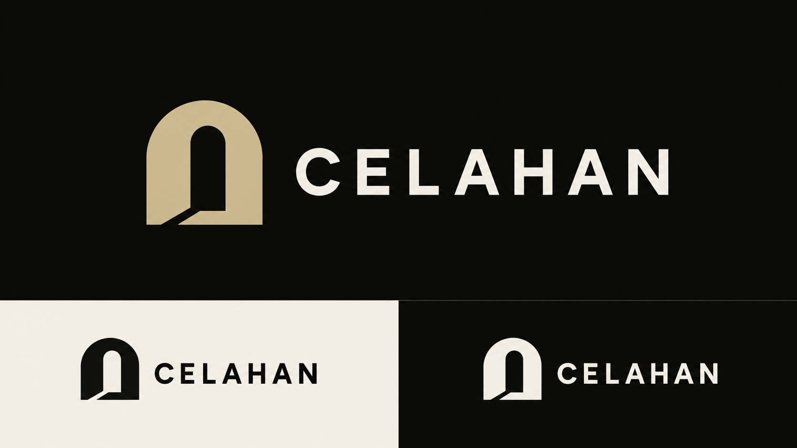

# CELAHAN — Open Threshold Logo

Updated: November 6, 2026
Status: Retained owner-selected identity; complete production exports pending
References: [Desktop baseline](DESIGN_DIRECTION.md), [Decisions](../planning/DECISIONS.md)

The owner selected Open Threshold on October 28. Its arch, offset open threshold and restrained uppercase wordmark remain the identity during the November 6 presentation reset. The logo reference is separate from the removed page-design references.

The retained PNG is 1,672 × 941 pixels, 1,169,161 bytes, SHA-256 09a88eddbaf43fa2422b5349f526fcc161215494645dce364e55c836756f14f0. [Brand manifest](../../design/brand/manifest.json) records its actual source/provenance.

The runtime symbol in public/brand/open-threshold.svg is a minimal editable path with an HTML wordmark, not the complete lockup/export set or a PNG wrapped in SVG. Layers retains this unchanged SVG as local favicon/header/footer identity. CSS renders it black on light surfaces and white on dark surfaces to match the selected reference without changing its source geometry.

Future production work must preserve aperture geometry/gap, document actual licensed lettering, check genuine small-size outputs and create only necessary vector/monochrome/transparent exports. Record real usage rights; visual approval is not trademark clearance, registration or a repository reuse license. Do not invent those results or select a replacement logo without an owner request.
