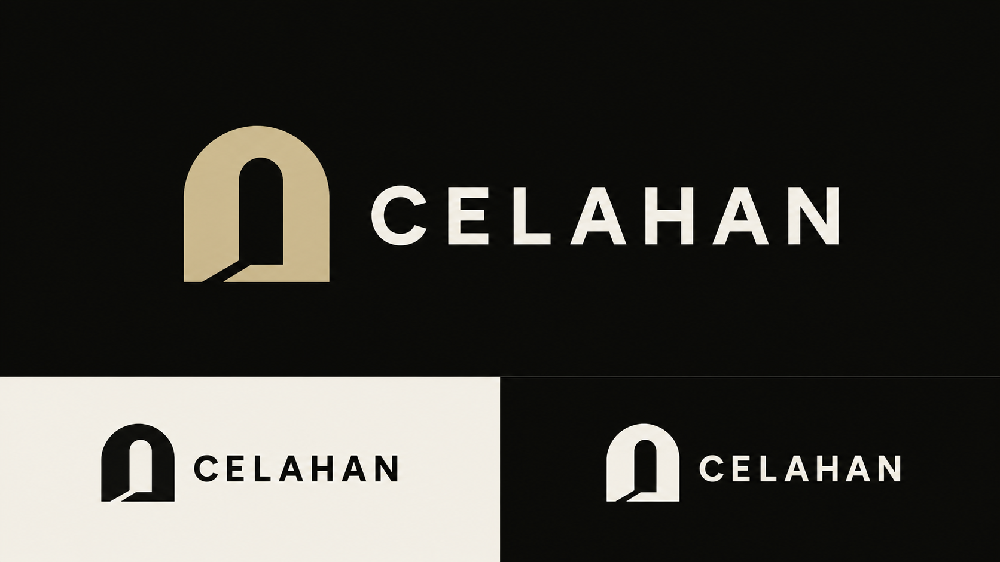

# CELAHAN — Approved Logo Guidelines

Status: Open Threshold approved by the owner on October 28, 2026  
Scope: Approved identity reference; editable production assets remain to be prepared

References: [Visual system](VISUAL_SYSTEM.md), [Design direction](DESIGN_DIRECTION.md), [Approved hero](DESIGN_REFERENCE_LOCK.md)

## Approved direction

The owner selected **02 — Open Threshold** as CELAHAN's logo and closed the choice between alternatives. Use its architectural arch, offset open threshold, and restrained uppercase wordmark. Do not create replacement directions without a new owner request. The logo works independently of the four pet mascots.

The PNG was moved unchanged from the selected concept sheet. Its SHA-256 remains `09a88eddbaf43fa2422b5349f526fcc161215494645dce364e55c836756f14f0`; it measures 1,672 × 941 pixels and 1,169,161 bytes. The [brand manifest](../../design/brand/manifest.json) records the source and generation prompt. Discarded C/wordmark alternatives and obsolete intermediate sheets have been removed at the owner's request.

## Identity and use

Use warm near-black, ivory, and restrained sand, consistent with the accepted website. Preserve the arch/aperture geometry, visible gap, wordmark spelling, and relative proportions. Use solid-color artwork; do not carry generated tonal variation, texture, shadows, glow, or raster antialiasing into the vector geometry.

The lower specimens in the reference demonstrate dark/light one-color appearance at presentation scale. They are not separate production exports or actual favicon-size tests. Existing website reference images keep their original placeholder header lettering until runtime integration; their approved layout and atmosphere remain unchanged.

## Production requirements

- Prepare genuine editable vector paths for the approved mark/wordmark; do not wrap the concept PNG in SVG and call it a vector master.
- Use original outlined lettering or document the actual licensed font choice. Preserve the accepted character while refining optical spacing and proportions.
- Export the horizontal lockup, wordmark, compact symbol, monochrome dark/light, and transparent fallback assets that the website actually needs.
- Check real 16/24/32px compact exports and the desktop/mobile header. Establish minimum size and clear space from those checks, rather than treating generic template values as measured rules.
- Store editable source and optimized runtime exports separately. Runtime files must contain only the necessary mark, not this entire presentation sheet.
- Record final usage rights. Approval of a visual direction does not establish trademark registration, legal clearance, a font license, or a repository reuse license.

W1 adds a minimal solid editable SVG symbol in `public/brand/open-threshold.svg`, with a real HTML wordmark and the same symbol as the local favicon. It is a shell export derived from this approved direction, not the completed vector lockup/outlined-lettering/export set. W1 header screenshots were reviewed; dedicated 16/24/32px production checks, final usage-rights review and the remaining exports are still pending. The approved PNG is unchanged. See [W1 validation](../validation/2026-10-30-w1-foundation.md).

