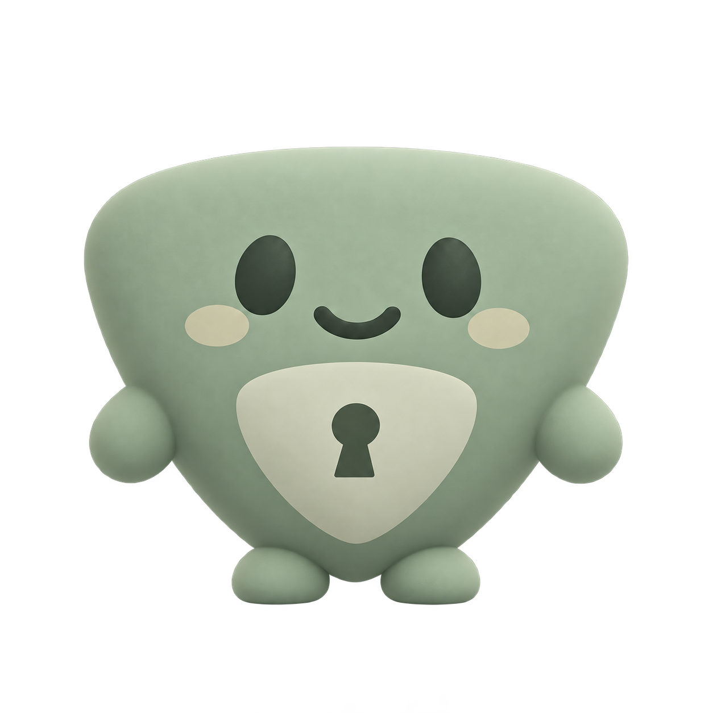
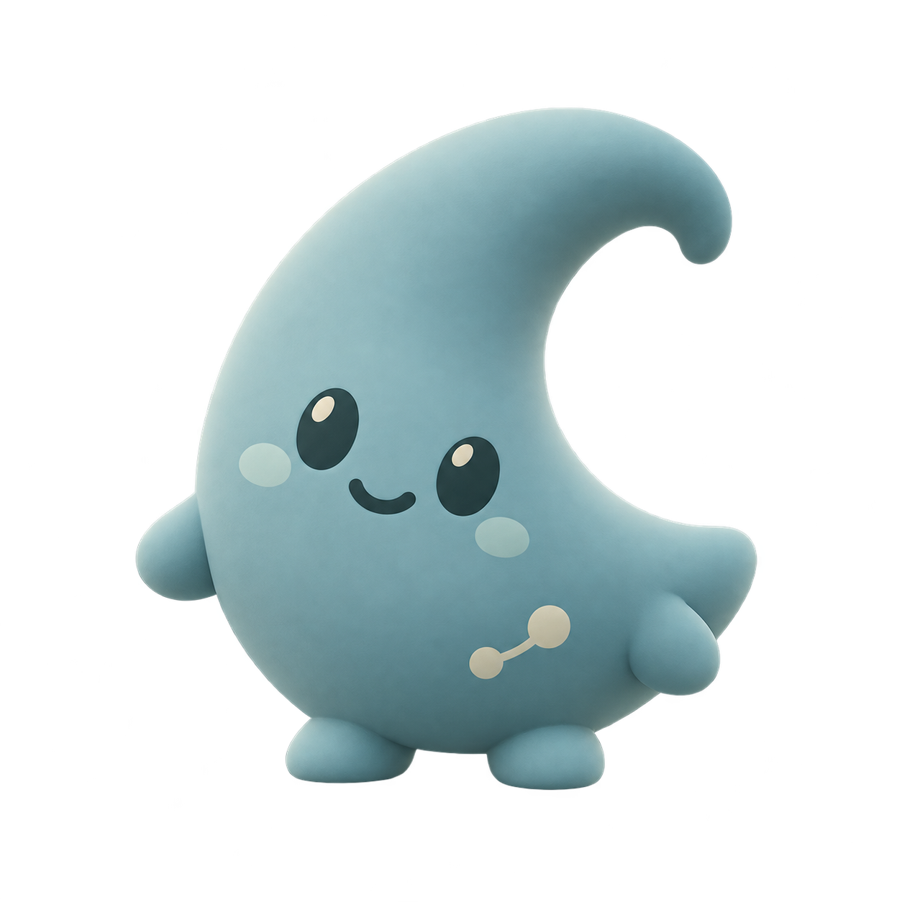
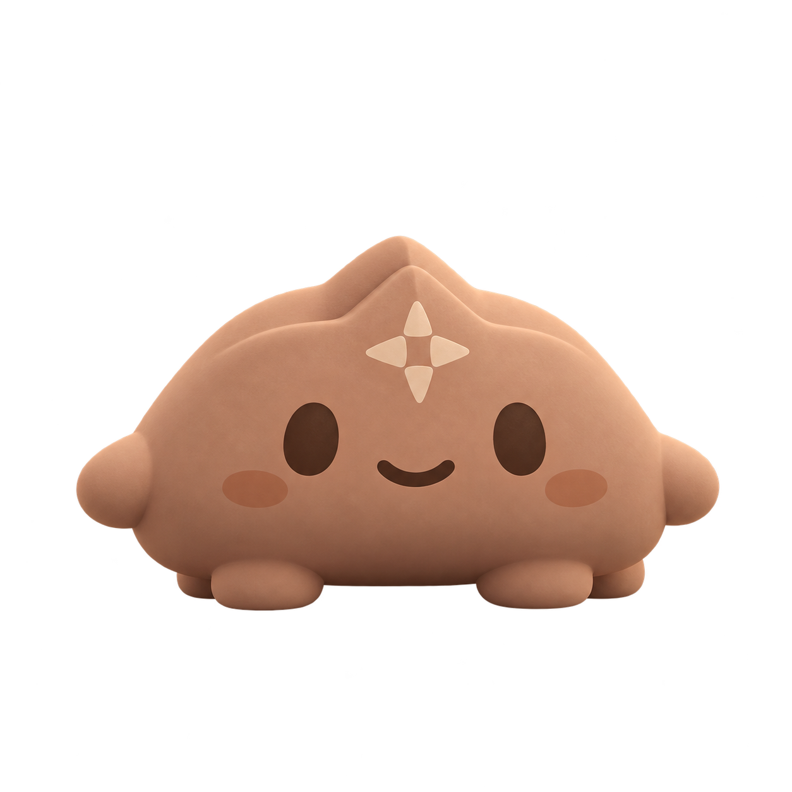

# CELAHAN — Mascot Family Guidelines

Status: Four v1 concepts generated for owner review; the approved desktop hero remains unchanged  
Updated: October 27, 2026  
References: [Approved Hero](DESIGN_REFERENCE_LOCK.md), [Visual System](VISUAL_SYSTEM.md), [Service Packages](../product/SERVICE_PACKAGES.md), [Decisions](../planning/DECISIONS.md)

## 1. Direction and approval

The owner requested four small pet forms with genuinely different body silhouettes and principal colors. This review set follows the approved hero's friendly face, compact proportions, soft matte 2.5D finish, and restrained light. The four individual concepts, role-to-form mapping, and proposed color values are drafts; producing them does not record owner approval of each character.

SCOUT is the proposed package identity closest to the sand pet in the hero. The original hero PNG is immutable: a new package concept must not silently replace the character in that approved composition.

## 2. Concept set

| Working name | Body silhouette | Proposed principal / detail colors | Distinguishing detail | Represented specialty |
| --- | --- | --- | --- | --- |
| SCOUT | Upright asymmetrical rounded pebble/bean | Sand `#D1BF8D` / olive `#716C43` | Small lens and geometric belly mark | Public website assessment; curious observation |
| WARDEN | Broad gently bowed top tapering into a rounded shield/wedge point | Sage `#91A88B` / pine `#34483B` | Pale keyhole inlay | Accounts, sessions, and access boundaries |
| NEXUS | Asymmetrical crescent with an obvious concave opening | Mineral blue `#7DA9AF` / petrol `#284B53` | Small two-node connector | Application/API relationships and business flows |
| ATLAS | Low wide dome with an integrated map-fold ridge and four small feet | Terracotta `#C8947A` / cocoa `#594036` | Small compass/map inlay | Coordinated multi-system scope |

The hex values are generation targets and proposed identity primitives, not exact measurements of every rendered pixel. Character colors do not become the interface's risk/validation palette or provide a security rating.

## 3. Review images

### SCOUT


### WARDEN



### NEXUS



### ATLAS



## 4. Shared construction rules

- One compact non-humanoid body, tiny paws/feet, dark oval eyes, and a restrained friendly smile.
- Silhouette differences carry identity before accessories or color are considered.
- Maintain the same material, facial simplicity, soft frontal/upper-left light, and illustration finish. No brilliant rim, glow, fur, metallic armor, humanoid limbs, literal Minecraft skin, or oversized props.
- Each pet can have its own proportions and pose while remaining small in the interface. ATLAS represents broader coordination without becoming a giant creature.
- Preserve each character's own face, body shape, palette, and distinguishing detail across guide, package, mobile, and future motion appearances.
- Do not use mascot animation or personality as evidence of an assessment, AI reasoning, repair, certification, or results from an entered address.

## 5. Placement, accessibility, and future exports

Package overview artwork should use optical sizing within consistent containers; do not stretch every body to the same width/height. Proposed displayed sizes: 80–160 px for overview art, 180–280 px for a focused desktop character, and 120–220 px for a focused mobile character. Review these values against actual screen layouts. The approved hero keeps its existing proportions.

Keep essential package names, scope, price labels, selected state, and navigation as HTML text/controls. Decorative character art can have empty alt text where the adjacent named control already explains it; otherwise provide a concise functional description. The guide remains optional.

These are source concepts, not optimized runtime exports or animation rigs. After owner review, inspect alpha edges on actual dark/light surfaces, small-size legibility, consistent margins, and compressed formats. Preserve original PNG concepts; save production exports separately. Do not copy the source assets directly into a runtime merely because they exist.

## 6. Production record and checks

Built-in image generation created four initial candidates and one WARDEN silhouette revision. The selected WARDEN review image is that revision. The rejected earlier WARDEN draft is not part of the saved set. No CLI, API key, additional dependency, or modification of the approved hero was used.

Each selected source was copied unchanged into `design/mascots/concepts/`. All are RGBA PNGs. Native pixel samples found alpha 0 at all four corners and alpha 253 at the image center for every file; this confirms actual transparency at the sampled locations, not an exhaustive alpha-edge audit.

| Character | Dimensions | Bytes | SHA-256 |
| --- | --- | --- | --- |
| SCOUT | 1254 × 1254 | 755,251 | `a5ba500ba9cc17920736b2b7989c52e53bfbec80b9066c8ecdf27e0b54b2030a` |
| WARDEN | 1254 × 1254 | 925,602 | `05ea2f5a4e56578a3d529c6e304aa9673805f6d2f084535a1a27f8ed7bc1589a` |
| NEXUS | 1254 × 1254 | 837,176 | `09000a8a82ab4258f1ea64a21448376f3021ed243fdcc8d29449815f7b4effca` |
| ATLAS | 1254 × 1254 | 652,444 | `36699b37cc5540e49d74c32a60f956e61eed7473390b79da8c4b3d952bba962b` |

These four working designs and their source records do not select a repository reuse license or establish a complete asset-rights audit.

## 7. Generation prompts

Each initial candidate used the approved hero PNG as its sole image reference and requested a genuinely transparent background. The common prompt plus the relevant extension below reconstructs that candidate's prompt. WARDEN's selected final revision additionally used the first WARDEN candidate as its edit target with the recorded revision prompt. The saved PNGs, not deterministic regeneration, preserve the actual outputs.

### Common prompt

```text
Use case: stylized-concept. Create ONE original CELAHAN small pet mascot concept as an isolated character asset. Square canvas, true transparent background, one full-body character centered, generous clear padding on every side, feet/paws fully visible, no text, no logo label, no scenery, no cards, no ground plane, no cast shadow outside the character. Reference image is the OWNER-APPROVED HERO: use only its little sand pet as the family style anchor. Do not render the website, stairs, portal, text, or background.

SHARED FAMILY RULES: compact tiny-pet proportions, a single continuous non-humanoid body, tiny paws/feet, friendly simple dark oval eyes, small restrained smile, clean silhouette, matte softly shaded 2.5D/clay-like finish without fur or realistic animal detail. Soft neutral frontal studio illumination with mild upper-left modeling, restrained highlights, no bloom, brilliant rim, neon, or glossy plastic. Match the visual care and warmth of the reference pet. No Minecraft person, cube head, separate human head/torso, long arms/legs, clothes, armored robot, game skin, pixel blocks, toy packaging, weapons, or certification badges. All four proposed characters must have genuinely different silhouettes and principal colors, not the same body recolored. Keep the requested one character only. Readability should survive small display size. Render a high-quality review concept, not a busy character sheet.
```

### SCOUT generation extension

```text
CHARACTER: SCOUT, observant and curious. Preserve the approved hero pet's identity particularly closely: upright gently asymmetrical rounded pebble/bean-shaped sand body with a subtly squared upper contour, two small side paws and two short rounded feet. Warm sand principal body around #D1BF8D, muted olive face and small geometric belly marking around #716C43, soft warm cheek accents. Friendly curious slight lean. A tiny simple olive-rimmed lens can rest in one paw as a secondary detail, no oversized prop and no hat. This is the sand SCOUT candidate; do not create green/blue/terracotta variants in this image.
```

### WARDEN generation extension

```text
CHARACTER: WARDEN, calm and attentive. A genuinely different body: broad softly rounded shield/wedge silhouette, wide at the upper body and gently tapering toward a rounded lower point, two tiny low side paws and two little feet. The shield-like contour IS its continuous pet body, not a separate shield held by the sand character. Muted sage/fern green principal body around #91A88B, deep pine facial features around #34483B, restrained pale sage belly inlay with one tiny keyhole motif. Stable grounded pose, reassuring friendly face. No pebble/bean Scout body, humanoid shoulders, armored suit, metallic shield, helmet, or sand principal color.
```

### NEXUS generation extension

```text
CHARACTER: NEXUS, curious about connections. A distinctly asymmetric curved crescent/comma-shaped continuous pet body, tapering into a soft curled upper tip, with a rounded fuller lower body, two tiny fin-like side paws and two short soft feet. Its crescent silhouette must be unmistakable in profile; do not make a round blob, shield wedge, cloud, or human. Dusty mineral blue/teal principal body around #7DA9AF, deep petrol face around #284B53, a tiny quiet two-node connector inlay low on the body. Warm friendly oval eyes and small smile, playful attentive slight tilt. Matte softly shaded material matching the approved pet. No neon circuitry, glowing eyes, rings around it, long tail, or giant props.
SILHOUETTE PRIORITY: the outer contour is visibly crescent-shaped, with a deep smooth concave cutout on one side and a curled upper point. Its asymmetry must remain obvious in a solid silhouette. Facial features are on the fuller side; keep the concave negative space. Do not fill the concavity into a bean-shaped body.
```

### ATLAS generation extension

```text
CHARACTER: ATLAS, composed and systematic. A distinctly low and wide rounded dome/dumpling pet, approximately one-and-a-half times wider than tall, one continuous body with four tiny rounded feet underneath and two very small side nubs. A subtle stepped central crest suggests a folded map, smoothly integrated into the dome rather than a hat or separate shell/head. Muted terracotta/clay principal body around #C8947A, dark warm cocoa face around #594036, restrained pale clay small four-point map/compass inlay. Friendly calm expression, squat grounded stance. Same compact pet scale and matte shading as the family; no large beast, humanoid, shield wedge, Scout bean, crescent, Minecraft cube, or oversized props.
SILHOUETTE PRIORITY: make a truly LOW WIDE DOME, four little feet along the underside, and a subtle centered map-fold ridge; it is much wider than tall. Its face belongs to this single low dome. Do not use the tall two-lobed bean shape of the reference pet or a separate head.
```

### Selected WARDEN revision

```text
Edit this WARDEN pet concept. Preserve its muted sage/fern green palette, dark pine oval eyes, friendly small smile, pale keyhole detail, matte softly shaded 2.5D material, tiny paws/feet, full-body centered square composition and TRUE transparent background. Keep one small pet and no text or scenery.

Change its BODY SILHOUETTE decisively into a broad rounded inverted-triangle/shield wedge: one gently bowed near-horizontal top edge, two clearly defined but generously rounded upper corners, and two sides converging toward a single rounded low central point. The top MUST NOT have the sand mascot's two asymmetrical bean lobes or a dip between them. The body contour itself is the shield/wedge pet; simplify the pale belly inlay so the outer shape carries the distinction. The point is part of the body between two tiny feet, not a large shield prop. Keep the character friendly and compact, no human torso/head, armor, helmet, robot, angular sharp points, cube, wings, bright glow, cast shadow, or background. Smooth clean alpha edges without stray flecks. The result must remain recognizable as WARDEN but look structurally different from a recolored rounded bean.
```

