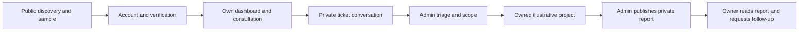

# CELAHAN — Account and Portal UX Specification

Status: Authored screen/interaction baseline for owner review; no new images or application implementation  
References: [PRD](../product/PRD.md), [User Flows](../product/USER_FLOWS.md), [Operations](../product/SERVICE_OPERATIONS.md), [Data and Access](../engineering/DATA_AND_ACCESS.md), [Visual System](VISUAL_SYSTEM.md)

## 1. Purpose and scope

Define the account, user and admin screens needed before producing new portal designs. Preserve the approved public hero/Open Threshold identity, four distinct compact pets and tight package cluster. The portal's task-focused layout must not repeat the marketing hero or require a mascot to navigate.

Confirmed foundations: Better Auth library in Next.js, Neon Free PostgreSQL, real private tickets/messages, illustrative assessment/report content, no code repair, and maximum three-month support starting at first private project report publication.

This document proposes screen organization, email/password enrollment, verification gating, admin authenticator use and detailed interaction states. Those authored details are not new owner approvals. [Decisions](../planning/DECISIONS.md) tracks review status. Operations remains authoritative for domain state/benefit rules; Data and Access owns permissions. This specification describes their presentation without inventing new statuses or rights.

Domain/registrar/DNS choice is deferred until needed for public email/deployment. Local development, a reviewed free deployment subdomain and isolated email testing do not depend on choosing a permanent domain. Public email enrollment remains gated by actual delivery/privacy readiness.

## 2. Definitions

| Term | Meaning |
| --- | --- |
| User | A signed-in account; prospect/customer is a project relationship, not a selectable role |
| Admin | A separately provisioned account authorized for administrative actions |
| Published report | A private illustrative report version made available to its project owner |
| Public sample | The unchanged five-finding example accessible without login |
| Shared reply | A ticket message visible to the ticket owner and authorized admin |
| Internal note | Separate admin-only content that never enters a user response |
| Unsaved draft | In-memory text that has not been committed to the database |
| TOTP | Time-based one-time password generated by an authenticator app |
| Support start | Server timestamp of the project's first private report publication |

## 3. Requirements, constraints and guidelines

| ID | UX requirement |
| --- | --- |
| UX-001 | Public discovery/sample access stays available without signup |
| UX-002 | Account forms clearly distinguish registration, verification, login and recovery |
| UX-003 | User navigation provides Overview, Tickets, Projects and Account |
| UX-004 | Overview adapts to owned records; a new user is not shown fabricated projects/statistics |
| UX-005 | Initial consultation exposes reactive/preventive/unsure choices and matching questions |
| UX-006 | Follow-up forms use authorized project/finding context instead of repeating initial intake |
| UX-007 | Ticket detail separates shared conversation, scheduling and admin-only notes |
| UX-008 | Admin queue prioritizes reviewable work using stored facts, not customer status alone |
| UX-009 | Project detail owns private report access, scope and support information |
| UX-010 | Publication explains illustrative provenance and the one-time support-start effect |
| UX-011 | Empty/loading/failed/denied/expired/stale states expose truthful next actions |
| UX-012 | Mobile and ID/EN retain equivalent data/actions; saved records survive locale changes |
| UX-013 | Auth/private screens expose only authorized data; navigation visibility is not security |
| UX-014 | Domain/email configuration remains replaceable and does not block current planning |

No target requests, code repairs, uploads, AI assistant, payment, public report sharing or automatic service/contact messaging is introduced. No fake scan log, completion percentage, user testimonial or business chart. Saved user/admin messages are separate from local scripted mascot guidance.

### 3.1 Account baseline for review

Propose name/email/password registration; defer company/contact collection until needed by consultation. No role/customer selector. Password-manager autofill, paste and a labeled show/hide-password control remain usable. Password limits/strength and request-rate policies follow a separately reviewed server configuration; do not invent a policy in the screen raster.

Propose verification before a user's first ticket submission/private project access. A pending-verification account can request a resend, correct the enrollment through the reviewed flow, log out or browse public content. Never show a working “email sent” success if the delivery integration is absent or failed.

Propose admin login through the same identity system followed by mandatory TOTP before administrative access. No public admin registration. Enrollment/recovery of the admin second factor uses a reviewed controlled procedure and recovery codes; email password reset alone must not bypass that factor.

Recovery responses avoid confirming whether an account exists. Invalid/expired/used verification or reset links provide a safe retry path. Use Better Auth's supported flow, redact link tokens from diagnostics and never add arbitrary return URLs. Recovery-session revocation, admin re-authentication and rate values require implementation review/tests.

### 3.2 Navigation and workspace

| Workspace | Desktop | Phone |
| --- | --- | --- |
| Public | Existing approved header; account/portal entry integrated without altering hero composition | Existing compact menu; accessible language/account entry |
| User | Compact task shell: Overview, Tickets, Projects, Account; identity and logout | Labeled menu with same destinations; active page heading and breadcrumb |
| Admin | Queue, Projects, Account; clear Admin workspace label and return to public site | Compact menu; queue records/details stacked with full actions |
| Account | Focused form, one primary action, clear links to alternative account tasks | One reading column; keyboard-safe fields and visible action/error text |

This is the proposed service-portal journey, not a scanner execution diagram. Verification/delivery policy and new screen visuals remain under review.

No mandatory bottom navigation, device-specific codebase, nested marketing navigation inside every panel, or secondary mascot-driven menu. Admin using the user workspace still sees only their own user records; broader authorized queries belong to the admin workspace.

### 3.3 Screen inventory

All paths below are proposed UI routes with id/en equivalents. Auth-library transport/callback paths are implementation details, not guessed external endpoints.

| Screen | Route example | Content and primary action | Important states |
| --- | --- | --- | --- |
| Login | /id/login/ | Email/password; Log in; links to registration/recovery | Invalid credentials, submitting, rate-limited, expired session |
| Registration | /id/register/ | Name/email/password; Create account; privacy/concept context | Validation, pending verification, generic duplicate-account handling |
| Verification | /id/account/verify-email/ | Delivery/pending context; Resend or return to login | Confirmed, expired/used link, delivery failed/unavailable |
| Recovery/reset | /id/account/recovery/ and /id/account/reset-password/ | Request reset; then set new password through provider flow | Generic acknowledgement, invalid/expired token, successful reset |
| Admin second factor | /id/account/two-factor/ | Authenticator code with reviewed recovery-code option | Wrong/expired code, rate-limited, recovery required |
| User overview | /id/dashboard/ | Next required action, own recent tickets/projects, consultation entry | New user, awaiting reply, active project, expired support |
| Ticket list | /id/tickets/ | Own records, type/status filters, New consultation | Empty, filtered empty, load failed, pagination |
| Consultation | /id/request/ | Need → context/contact → proposed time → submit | Conditional fields, unsure/mixed, invalid, failed/duplicate save |
| Ticket detail | /id/tickets/[ticketId]/ | Status, shared thread, reply, proposed/confirmed schedule | Awaiting user, save failed, closed, stale action |
| Project list/detail | /id/projects/ and /id/projects/[projectId]/ | Owned scope/stage, published reports, support entry | No project/report, awaiting publication, active/expired benefits |
| Private report | /id/projects/[projectId]/reports/[reportId]/ | Published version and illustrative findings; request guidance/retest | Missing/foreign/draft/withdrawn report, version update |
| Admin queue | /id/admin/ | Stored triage list; open next ticket | New consultations, project support, no results, stale record |
| Admin ticket | /id/admin/tickets/[ticketId]/ | Shared reply, separate note editor, schedule/status/priority | Wrong context, unsaved reply, failed/stale mutation |
| Admin project/report | /id/admin/projects/[projectId]/ | Owner/scope, illustrative progress, draft/report publication, retest review | Draft incomplete, publish confirmation, concurrency conflict |
| Account | /id/account/ | Own basic profile and security/logout actions | Save failed, session expired; email/role changes not ordinary profile edits |

Public /id/report/ remains the separate sample page and never displays a user's private project data. Direct private links require server authorization. Missing and unauthorized resources use a consistent generic response without revealing names, counts or report existence.

### 3.4 User overview

Use a clear page title and one relevant primary action. For a new user: short empty explanation, Request free consultation, and optional public sample access. Do not fill empty space with fictional charts or identical empty cards.

For a user with records: surface pending user replies and confirmed/requested appointments, then a concise owned-ticket list and owned-project list. Any operational counts come from authorized database queries and describe actual portal records, not company achievements. A user may have both a consultation and an existing project.

Each project summary shows scope/package, illustrative stage, published-report availability and support state. Before first publication show “Support has not started”; after publication show actual start/expiry. At expiry show benefits ended, with report/history access retained according to policy.

### 3.5 Consultation and follow-up

Use three readable sections within one form: need; website/problem; contact/timing. Do not create a long multistep wizard or a new account-registration step in every section. Company is proposed optional for individuals. Permit “discuss timing” instead of forcing an arbitrary calendar slot.

Reactive reasons show user-reported symptoms, never a verified incident badge. Preventive reasons explain goals without certification promises. Unsure/mixed users can describe context without being forced into a package. Keep entered website text inert; no preview/check button.

The selected package is an optional expression of interest. Profile details may prefill; the user confirms ticket-specific data. Explain actual saving, concept status, initial authority declaration and no target access. After success show the saved record and pending admin decision, not an invented confirmed meeting.

Support/retest/follow-up forms require an owned project selected from trusted records. Retest adds a published finding reference and programmer-change description. Show eligibility/remaining cycles without accepting a user-edited customer flag. Expired/exhausted benefits explain a reviewed next step; users can still read their existing records.

### 3.6 Ticket detail and admin triage

Desktop ticket detail: main conversation column and compact contextual column for status, project and schedule. Phone: title/status, next required action, schedule summary, conversation and in-flow reply composer. Long contacts/IDs wrap; no horizontal page scrolling.

Every shared message shows actor, actual portal timestamp and plain text. Message submission preserves text until confirmed saved. A failed save offers retry without duplicating the message. No typing indicator, live-presence promise or websocket dependency.

Admin shared-reply and internal-note editors have unmistakably different headings and submit labels. Never reuse one textarea with a subtle visibility switch. Internal notes are absent from user HTML/JSON/RSC, including hidden elements. Pending text in either editor triggers an unsaved-edit warning.

Admin queue initially separates consultation from project support/retest/follow-up. Show safe summaries: ticket type/reference, relationship, reported impact, reviewed priority, age and next required action. Do not fetch/show full personal narratives in every row. Status filters/sort are bounded server queries; no “urgent” priority assigned merely by a user's claim.

Proposed slots and confirmed time have different labels. Admin confirmation/rescheduling names the instant/timezone and expected change, detects a stale version, and records an explanation. No external booking or outbound service message is implied.

### 3.7 Project, report and support

Project detail is the home for scope, stage, published reports and support rights. A draft report is not listed for users. Public sample is labeled and visually separated from project reports so it cannot be mistaken for personalized findings.

Private report header: project context, version/publication date and visible illustrative label. Render five canonical fields from the authorized snapshot; ID/EN views share the same records. Desktop table and phone disclosures preserve every field. No clickable target paths, credentials/evidence viewer, PDF/share button or auto-repair action.

Admin publication confirmation names the owner/project, confirms illustrative provenance and explains that first publication starts the three-month support period. Publishing a later version explains that the original period is unchanged. Missing permission/scope context, incomplete required snapshot or a stale version blocks the action with a specific admin-facing correction.

The user reports programmer changes using “Report a fix,” not “Mark verified.” Admin review adds a separate explicitly illustrative outcome, never rewrites the canonical source or published version. Support cards show actual start/expiry and reviewed cycle state; discount percentage/actions remain absent until terms are approved.

## 4. Interfaces and data presentation contracts

Screen components consume authorized server data; they do not invent resource ownership or implement a parallel permission model.

| UI contract | Required fields / rules |
| --- | --- |
| Workspace context | Locale, allowed workspace, safe display name, reviewed account/second-factor state; no raw provider token |
| Ticket summary | Reference/type/status, safe related-project label, permitted next action and timestamp; scoped to actor |
| Ticket detail | Shared messages and scheduling only for user view; separate authorized admin note data |
| Project summary | Owned ID/scope, illustrative stage, published-report links, optional support dates/cycle summary |
| Report view | Authorized published version, five snapshots, illustrative source and allowed follow-up actions |
| Save result | Confirmed persisted resource or localized safe error; no success before transaction outcome |
| Publication result | Immutable version plus support start/expiry once; no client-provided start date |
| Auth form result | Localized safe state; no account enumeration or provider exception/token dump |

Exact schema/types live in Data and Access and selected Better Auth integration. Date display includes timezone; server calculates eligibility. A cached UI “enabled” state never authorizes a mutation.

## 5. Acceptance criteria

| ID | Given / when / then |
| --- | --- |
| UX-AC-001 | Given no login, when public sample is opened, then all five findings are available without identity input |
| UX-AC-002 | Given a new account, when verification is pending, then the draft gating policy prevents ticket/project writes and offers a truthful resend path |
| UX-AC-003 | Given an uncompleted admin second factor, when an administrative data/action endpoint is requested, then server access is denied regardless of visible navigation |
| UX-AC-004 | Given no owned records, when dashboard loads, then one useful consultation action replaces fictional projects/statistics |
| UX-AC-005 | Given any need category, when it changes, then matching questions/validation update without making an automatic diagnosis |
| UX-AC-006 | Given programmer changes, when a retest is requested, then trusted project/finding context is required and no verified status is self-assigned |
| UX-AC-007 | Given an admin note, when the owner requests the ticket, then no note body or metadata is serialized |
| UX-AC-008 | Given a proposed slot, when admin confirms it, then the user sees a confirmed timestamp/timezone only after persistence |
| UX-AC-009 | Given first private publication, when it commits, then support starts once; later versions and first reading cannot restart it |
| UX-AC-010 | Given a foreign/draft/withdrawn report ID, when opened, then no private content or revealing metadata is returned |
| UX-AC-011 | Given a failed/stale save, when retry is chosen, then text is retained and no duplicate record or false success occurs |
| UX-AC-012 | Given saved records, when locale/viewport changes, then data/rights/support dates remain unchanged |
| UX-AC-013 | Given no permanent domain, when isolated development/design continues, then no domain purchase or public-delivery claim is required |
| UX-AC-014 | Given either locale at 320 px, zoom or keyboard-only input, when core tasks are attempted, then all fields/actions and labels remain accessible |

These are planned acceptance cases, not test results. UX-AC identifiers are local to this specification and supplement existing PRD acceptance criteria rather than renumbering them.

## 6. Test automation strategy

Use focused unit checks for conditional field selection, safe route mapping and label/data consistency; integration checks for auth/verification/second-factor gates, object queries, internal-note DTOs and publication invariants; E2E checks for full user/admin paths, failed saves and phone/keyboard behavior.

Reuse proposed project runners from Architecture when implementation begins. Use two isolated users, an admin, synthetic projects/reports and an isolated test email sink. Never expose verification/reset links in shared logs or published screenshots. CI/provider configuration remains unimplemented; no coverage percentage or completed pipeline is asserted.

Map UX-AC-001–014 to Quality T-01–30 during detailed implementation planning. The draft verification/second-factor gates specifically extend T-16/T-28. Public email delivery needs separately verified domain/provider setup before opening registration; mocks are not evidence of deliverability.

## 7. Rationale and context

A shared user role avoids false customer privileges; project relationships grant exact resource rights. Different ticket forms collect relevant context without repetitive identity fields. Separating shared replies/internal notes reduces wrong-recipient errors and supports server-side data isolation.

The portal uses the approved dark/ivory/sand identity with readable sans-serif content, restrained technical labels and optional compact pets. Task density and mobile reflow take priority over repeating the marketing hero. Actual screen/asset approval and browser quality evidence remain separate milestones.

## 8. Dependencies and external integrations

Better Auth + Neon Free are selected; exact version/adapter/session details remain open. Email/password and authenticator flows above are proposals using supported capabilities, not installed integrations. No new dependency or provider account is created by this spec.

Permanent domain, registrar, DNS and email sender selection remain deferred. The owner's existing .my.id domain is one possible option, not a locked requirement. Deployment origins, trusted callbacks and sender settings must be configuration-driven; a later domain change requires reviewed cookie/redirect/email configuration and tests.

No automatic service email/WhatsApp/calendar integration, AI model, upload store, analytics or billing dependency is added. Privacy/enrollment/retention decisions remain gates before real identity/data collection.

## 9. Examples and edge cases

- A logged-in prospect has one consultation but no project: show the ticket and “No project yet,” without a customer upgrade control.
- A project owner submits another unrelated consultation: keep initial intake available; do not force every request into support.
- A verified user opens another owner's report URL: show generic unavailable content with a route back to their own projects; reveal no foreign details.
- A password reset succeeds for an admin: require the reviewed second-factor/recovery flow before admin access.
- The first published report is withdrawn and replaced: maintain the original support start; do not offer another three months.
- A free deployment URL is used during isolated testing: use configured trusted origins and a test email sink; do not claim public reset-email delivery.
- A message is being edited when language changes: prompt about unsaved text only; preserve all database records.

## 10. Validation and next review

First review this account/navigation/screen baseline and the remaining auth/privacy choices. Then produce requested desktop portal references, followed by separately composed phone views, preserving the accepted public direction. Group design work into account, user workflow and admin workflow batches with reusable states; do not make every control its own milestone.

After relevant review, turn the broad Implementation Plan into coherent usable implementation packages. This spec does not authorize image generation, code, account provisioning, domain/DNS changes, email sending, deployment or Git operations.

Documentation validation checks links/tables/IDs and preservation only. No claim of implemented UX, passed browser testing or complete security is made.

## 11. Related specifications and sources

- [Design Direction](DESIGN_DIRECTION.md), [Approved Hero](DESIGN_REFERENCE_LOCK.md), [Shared Visual System](VISUAL_SYSTEM.md).
- [PRD](../product/PRD.md), [User Flows](../product/USER_FLOWS.md), [Operations](../product/SERVICE_OPERATIONS.md), [Data and Access](../engineering/DATA_AND_ACCESS.md), [Quality](../engineering/QUALITY_AND_SECURITY.md).
- [Better Auth email/password](https://better-auth.com/docs/authentication/email-password) and [authenticator support](https://better-auth.com/docs/plugins/2fa), checked October 29, 2026.
- [OWASP authentication](https://cheatsheetseries.owasp.org/cheatsheets/Authentication_Cheat_Sheet.html) and [authorization](https://cheatsheetseries.owasp.org/cheatsheets/Authorization_Cheat_Sheet.html), checked October 29, 2026. Security behavior requires implementation and verification; a hidden navigation link is not access control.
