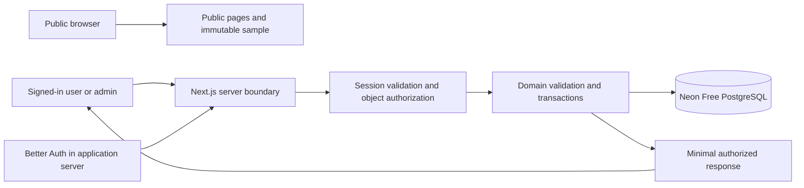

# CELAHAN — Architecture

Status: Better Auth + Neon Free selected; integration/version decisions remain open; not implemented  
Updated: October 29, 2026  
References: [PRD](../product/PRD.md), [Flows](../product/USER_FLOWS.md), [Data and Access](DATA_AND_ACCESS.md), [Quality](QUALITY_AND_SECURITY.md)

## 1. System boundaries

Next.js App Router and TypeScript remain required. A server-capable application and relational database replace the earlier static-export-only baseline. Public content can still be prerendered where appropriate. Private operations must execute through an authenticated server boundary.



There is deliberately no edge to a submitted website, scanner, AI service, public file bucket, payment provider or outbound contact channel. Database/auth infrastructure are permitted; input-derived target requests remain forbidden.

## 2. Technology decisions and sources

The owner selected Better Auth's open-source library running in CELAHAN's Next.js server and Neon Free PostgreSQL. Vercel remains the hosting target. No paid plan/add-on or automatic upgrade is authorized. Select compatible stable framework/auth/runtime versions, a database adapter/migration tool, pooling and deployment configuration before coding. Verify limits, regions, quota/idle behavior and hosting terms; do not provision anything during documentation work.

Checked October 29, 2026: Better Auth core is [MIT-licensed](https://github.com/better-auth/better-auth/blob/main/LICENSE.md); [Neon Free](https://neon.com/pricing) lists 1 GB storage and 100 CU-hours per project/month with idle scale-to-zero. This selection uses Neon for PostgreSQL and Better Auth in the application server; no managed-auth service is being configured. Quotas and cold-start performance require actual monitoring/testing. Core software availability does not make email/domain/hosting usage unlimited or permanently free.

Permanent domain/registrar/DNS selection is explicitly deferred. The existing .my.id domain is one possible choice; the owner may choose another later. Do not require its name/DNS provider for current planning or isolated development. Keep deployment base URL, trusted auth origins/callbacks and sender identity configuration-driven. Changing them later requires reviewed cookie/redirect/email tests, not sharing sessions across domains automatically.

Use local development/a reviewed deployment subdomain and isolated email testing while no public email domain is selected. Real public verification/recovery delivery requires an approved sender/provider and verified configuration; test email sinks do not prove deliverability. Resend remains only a candidate whose [domain requirements](https://resend.com/docs/dashboard/domains/introduction) need review. No purchase, DNS change, provider setup or email dispatch is authorized.

Prefer an established maintained authentication solution over custom cryptography. Authentication does not replace authorization. Keep a server-only data-access layer that returns minimal authorized fields. The design follows [Next.js authentication](https://nextjs.org/docs/app/guides/authentication) and [Next.js data security](https://nextjs.org/docs/app/guides/data-security), checked October 29, 2026. These sources guide architecture, not a version compatibility guarantee.

Provider-specific SDKs, schema validators and test runners require a recorded reason before installation. No package, lockfile, runtime or application exists yet.

## 3. Request path

Each protected operation follows: validate request origin/CSRF protections where applicable → validate session → check role and resource relationship → validate allowlisted fields → execute scoped query/transaction → emit minimal result and safe audit event.

Server Actions and/or Route Handlers are transport options to choose during foundation work. Treat either as directly callable endpoints. Hiding a button or protecting a layout is insufficient. Do not duplicate authorization in unrelated UI components; reuse domain checks at the data boundary and test every transport.

Never trust body-supplied actor, role, owner, customer status, priority, report publication state or benefit dates. A client-provided project ID is a request to access a resource, not proof of ownership. Bound searches/pagination and use parameterized queries through the selected adapter.

Mutation retries use actor/action-scoped idempotency records, payload hashes and unique constraints. Enforce report publication, support reservations and schedule changes transactionally, with optimistic concurrency/version checks where appropriate.

## 4. Authentication and sessions

Better Auth owns credential/session/recovery logic in the application server; its supported schema persists in Neon. Proposed browser boundary: secure, HttpOnly authentication cookies with reviewed SameSite, scope, expiry and revocation behavior; production HTTPS. No auth tokens or credentials in localStorage, public environment variables or URLs.

If passwords are selected, use Better Auth's supported password hashing and recovery flow; never store plaintext or implement a homegrown hash. Verification/recovery delivery and enrollment must be settled before public registration. No shared administrator credentials or public admin signup. Require stronger admin authentication/re-authentication using capabilities verified for the chosen provider.

Rate-limit login/recovery and data mutations using server-side controls that work across server instances. Session logout/revocation and disabled-account checks must affect private operations immediately according to the reviewed session policy. Exact timeout/rate values are decisions, not fabricated defaults.

Use provider-supported CSRF/origin protections plus endpoint-specific tests; SameSite alone is not a universal defense. Never disable security checks to make cross-origin requests work. See [OWASP session management](https://cheatsheetseries.owasp.org/cheatsheets/Session_Management_Cheat_Sheet.html) and [CSRF prevention](https://cheatsheetseries.owasp.org/cheatsheets/Cross-Site_Request_Forgery_Prevention_Cheat_Sheet.html).

## 5. Domain and persistence

[Data and Access](DATA_AND_ACCESS.md) owns entities, relationships, access matrix and transactional invariants. [Service Operations](../product/SERVICE_OPERATIONS.md) owns ticket/project/report/support rules. Avoid independently redefining statuses and expiry calculations in UI code.

Separate account identity, customer/project relationship, ticket state, project stage, report publication, support start, source finding status and retest outcome. The first private project report publication atomically sets support_started_at and expiry once; project activation is separate. Later versions/withdrawal/republication cannot restart the benefit. A three-month benefit is not a database retention policy.

Public sample data stays local and immutable. Private illustrative report snapshots persist in the database and preserve provenance. Users submit change assertions; admin review events do not overwrite canonical findings or immutable published versions.

## 6. Planned structure

This is a responsibility map, not authorization to create empty folders or final filenames. Route groups may organize access boundaries but must not create a separate portal layout. Header capabilities come from the current server session/project relationship; every protected request still performs its own authorization.

```text
src/
  app/
    [locale]/
      layout.tsx       # Shared site header/footer, ID/EN and account controls
      (public)/        # Home, services, process, about, sample, privacy
      (account)/       # Ordinary auth/profile tasks within the shared layout
      (authenticated)/ # Tickets, progress, private reports; no dashboard shell
      admin/           # Authorized task content in the same site layout
    api/               # Only Route Handlers actually selected
  components/
    layout/            # One header/footer and conditional account/navigation controls
    ui/                # Small accessible reusable primitives
  features/
    consultations/     # Conditional intake and scheduling
    tickets/           # User/admin conversation and ticket actions
    projects/          # Scope, relationship and project stages
    reports/           # Public sample and private version presentation
    support/           # Eligibility and bounded retest requests
    packages/          # Public package selection and detail
    companion/         # Optional local scripted guide
  server/
    auth/              # Provider integration and trusted session context
    data/              # Authorized queries, DTOs and persistence adapter
    domain/            # Validated transitions, support policy, transactions
    audit/             # Minimal privileged-action metadata
  content/             # Shared package definitions, canonical findings, ID/EN
  lib/                 # Locale/routes and genuinely shared pure utilities
  styles/
database/              # Reviewed schema, migrations and synthetic-only seeds
tests/
  unit/
  integration/
  e2e/
public/                # Optimized public brand/pet/font assets only
```

Route groups do not change public URLs or enforce access. Private reports never belong under public/. Keep provider keys and server modules out of client imports. Schema/migrations may be versioned; database dumps, credentials and real personal fixtures may not.

## 7. Routing, locales and browser state

Use allowlisted id/en prefixes with shared typed dictionaries and correct server-rendered html language. Resource paths may contain opaque internal IDs after authorization; they never contain input website/contact/message values.

Saved records survive locale changes, reload and new tabs. Language switching does not need the retired reset-demo confirmation. Warn only before discarding unsaved edits. Browser state contains ephemeral drafts/panel selections; no persistent private browser cache/offline storage. Public language choice may remain in the path.

Logout/account switch must clear client query/router state and revalidate restored private documents. No browser-cache strategy can replace server authorization; test Back, multi-tab and cross-account transitions.

## 8. Caching, metadata and privacy

Private pages/responses use a verified no-shared-cache strategy, with Cache-Control private, no-store where appropriate. Do not statically generate private routes, use shared data caches keyed only by report ID, or serialize full database rows into client props. Test the selected framework's HTML, data and RSC responses, CDN behavior and back/forward restoration.

Public pages/sample may be cached independently. Private routes and auth screens use noindex and stay out of sitemaps/social previews. Robots/noindex are not access controls. No personalized metadata or private Open Graph images.

Logs/audit events contain minimal metadata, never session tokens, contact contents, website inputs, problem narratives or report bodies. Infrastructure request logs must be reviewed; sanitize/redact allowed resource identifiers where needed. Observability is not permission to export private content.

## 9. No target access

Validate website syntax as text only, on both client and server. Never resolve DNS, fetch a page, inspect a favicon, embed a preview, validate availability or construct input-derived href/src/CSS URLs. Store escaped text only in the authorized database.

Tests intercept before page load and before server egress; cover external, localhost/private-network, metadata-like and same-origin targets without allowing requests to reach them. Database/auth traffic follows a fixed configuration allowlist. The fact that server networking exists does not permit target networking.

## 10. Hosting, secrets and operational gates

Secrets are allowed only in approved local/hosting secret storage after provisioning is authorized. Never commit them, display values in docs, prefix secrets for client exposure, or include them in browser bundles. An example environment file may contain variable names and safe placeholders only when the provider is chosen.

Use separate development/test/preview/production credentials and databases. Preview builds must not read production private data. Run reviewed migrations through controlled credentials; application credentials use least privilege. Pooling, backups, restore tests, retention and deletion propagation must be defined before public data intake.

Planned scripts: dev, lint, typecheck, test, test:integration, test:e2e, build, start, plus selected migration tooling. These commands do not exist yet. Build success does not imply lint ran, database authorization passed or deployment is secure.

Headers/CSP must accommodate real first-party forms/auth, unlike the retired form-action none design. Derive form-action, connect-src and allowed callbacks from the chosen architecture; use exact necessary origins, not broad wildcards. Verify hydration, cookies, CSRF, 404 and private caching on the production deployment.

## 11. Open gates and limits

Before foundation: select the remaining adapter/runtime/transport, enrollment, email recovery and admin provisioning details for Better Auth + Neon Free. Before benefit code: review date semantics/cycle rules; the first-report publication trigger is confirmed. Before public intake: approve personal-data policy, retention/deletion/backups, abuse controls and hosting terms. Before visual implementation: review the authored [Portal UX Specification](../design/PORTAL_UX_SPEC.md) and missing portal/admin screens while preserving the approved public direction. Domain identity remains a later public-email/deployment gate, not a flow-design prerequisite.

No source inspection, diagram or documentation check is an application security or performance test. See Quality for executable acceptance expectations.
